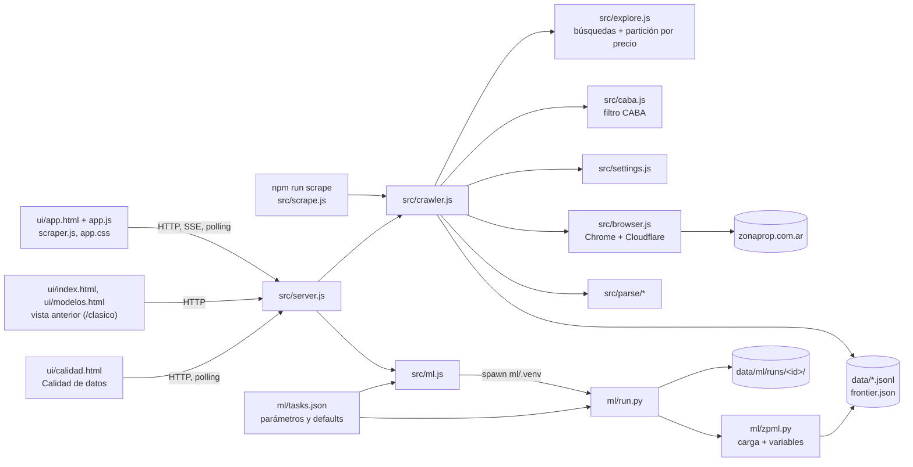

# zonaprop-scraper

Scraper de avisos de [ZonaProp](https://www.zonaprop.com.ar) para la Ciudad de Buenos Aires, con
interfaz web local y una sección de modelos de datos.

- **Sólo CABA por defecto**: busca en `capital-federal` y descarta avisos de otras zonas.
- **Scraper** Node.js + Puppeteer (Chrome real) que recorre listados y, opcionalmente, fichas.
  Retoma donde quedó y parte las búsquedas grandes por rango de precio.
- **Interfaz** en <http://localhost:3210>: una sola aplicación con seis secciones en orden
  (Inicio → Datos → Predecir precio → Resultados por modelo → Experimentos → Historial y docs).
  Ver [Interfaz](#interfaz).
- **Modelos**: seis análisis en Python (precio, oportunidades, rentabilidad, segmentos, texto,
  supervivencia) más la ablación A2, con parámetros, barra de avance y resultados.
- **Calidad de datos** en <http://localhost:3210/calidad>: EDA de control de los datos scrapeados
  (controles básicos, limpieza, duplicados y fuga, faltantes, representatividad, deriva del scraper).
- **Notebooks** `notebooks/00_calidad_datos.ipynb` (calidad de datos) y
  `notebooks/01_price_prediction.ipynb` (modelo de precio paso a paso).

## Arquitectura



| Pieza | Rol |
| --- | --- |
| `src/explore.js` | Arma las búsquedas (operación × tipo × zona) y las parte por precio cuando superan el tope de páginas. |
| `src/crawler.js` | Orquesta fase 1 (listados) y fase 2 (fichas), pausas, reintentos y verificación de Cloudflare. |
| `src/caba.js` | Barrios de CABA; filtro de URLs y de la `location` de cada aviso. |
| `src/settings.js` | Parámetros saneados (`data/settings.json`); fuerza CABA si `soloCaba`. |
| `src/server.js` | Servidor local (sólo 127.0.0.1): interfaz (`ui/app.html`, vista anterior en `/clasico`), API del scraper, CSV y API de modelos. |
| `src/ml.js` | Lanza `ml/run.py` como proceso hijo (uno a la vez), lee el avance, permite cancelar. |
| `ml/run.py`, `ml/zpml.py` | Entrenamientos A–F; carga, filtro CABA y variables compartidas con el notebook. |
| `ml/calidad.py` | Chequeos de calidad de datos (tarea `quality`, página /calidad y notebook 00). |
| `config.js` | Configuración técnica (puerto, navegador, tiempos). |

## Requisitos e instalación

- Windows 10/11, Google Chrome y conexión residencial (Cloudflare bloquea datacenters y VPN).
- Node.js 22.12+: `npm install`.
- Para Modelos y el notebook, Python 3.11–3.13 (por ejemplo, Anaconda):

```powershell
python -m venv ml\.venv
ml\.venv\Scripts\python.exe -m pip install -r ml\requirements.txt
```

La interfaz usa `ml\.venv` sola; otra instalación se indica con la variable `ZP_PYTHON`.

## Uso

- **Interfaz**: doble clic en `Iniciar ZonaProp Scraper.bat` (instala lo que falte) o `npm start`.
  Cerrar la ventana negra detiene todo.
- **Por consola**: `npm run scrape` con los parámetros guardados. Flags: `--solo-listado`,
  `--solo-detalle`, `--limite N` (tope de fichas), `--headless` (sólo después de una corrida con
  ventana que haya pasado la verificación).
- **Retomar**: el avance queda en `data/frontier.json` y cada aviso se escribe apenas se lee
  (dedupe por `id`). Cortar con Ctrl+C o *Detener* es seguro; la próxima corrida sigue en la
  misma búsqueda y página. *Volver a explorar desde cero* reinicia el recorrido sin borrar avisos.
- **Una corrida a la vez**: no uses *Iniciar* en la interfaz mientras corre `npm run scrape`;
  escribirían los mismos archivos.
- **Ritmo**: una página (30 avisos) cada ~5 s, con pausas de 2–4,5 s y un solo navegador. Si
  aparece la verificación de Cloudflare, hay que tildar el casillero en la ventana de Chrome.
  No borres `.perfil-chrome/`.
- **CSV**: botones de la interfaz o `npm run csv`.
- **Tests**: `npm test` (parsers contra capturas reales, exploración, CABA y cableado de
  modelos; corre un entrenamiento sintético si existe `ml\.venv`).
- **Diagnóstico**: `node scripts/inspect.js <url>` guarda HTML y captura en `debug/`.

## Sólo CABA

Activo por defecto (`soloCaba: true` en `src/settings.js`):

1. **En origen**: la única zona buscada es `capital-federal`; las URLs pegadas a mano sólo se
   aceptan si apuntan a CABA o a un barrio porteño.
2. **Filtro de seguridad**: ZonaProp rellena búsquedas chicas con otras zonas, así que cada aviso
   se guarda sólo si su `location` termina en *Capital Federal* o en un barrio de CABA
   (`Palermo, Capital Federal`, `Las Cañitas, Palermo`). Los descartes quedan en el registro.
3. La fase de fichas saltea avisos fuera de CABA ya guardados.

Para volver a todo el país: `"soloCaba": false` en `data/settings.json` (la interfaz todavía no
tiene ese interruptor; con `soloCaba` activo el campo de zonas se ignora).

## Interfaz

`ui/app.html` (sin frameworks; rutas por `#hash`). Primero resúmenes y, al tocar, el detalle:

1. **Inicio** (`#inicio`): qué es el proyecto, números del dataset, evolución del error de A.
2. **Datos** (`#datos`): estado del scraper, descargas CSV, embudo de limpieza; la configuración
   de la búsqueda, las opciones avanzadas y el registro están plegados.
3. **Predecir precio** (`#predecir`): formulario corto (barrio, m², ambientes, baños, dirección);
   "Más características" y "Opciones avanzadas" (corrida guardada, tipo) plegadas. El resultado
   muestra precio, USD/m², rango 80 % / 50 %, mediana del barrio y error típico en ese barrio.
4. **Resultados por modelo** (`#modelos`): una tarjeta por modelo (A–F y A2) con su pregunta y
   2–3 números clave; el detalle trae el último resultado, sus corridas y **Entrenar** (los
   parámetros quedan en "Opciones avanzadas").
5. **Experimentos** (`#experimentos`): todas las corridas (filtros por modelo y estado),
   comparación de variantes de A, ablaciones A2 y qué cambia cada variante.
6. **Historial y docs** (`#docs`): `docs/historial_modelo_precio.md` y `docs/modelo_precio.md`
   con índice.

**Modelo seleccionado**: el selector "Modelo" de la barra superior (o una tarjeta) agrega
`&modelo=A` (A, A2, B…F) al hash. Una franja fija muestra el modelo y su pregunta, y todas las
secciones pasan a mostrar sólo ese modelo (números, corridas, experimentos, docs; Predecir sólo
con A). **✕ Ver todos los modelos** vuelve al resumen. Cada corrida se abre en `#corrida=<id>`.

Las pantallas anteriores siguen enteras en `/clasico` (scraper) y `/clasico/modelos`.
Capturas: `node scripts/ux-screenshots.js` (con el servidor andando) → `debug/ux/`.

## Modelos

En **Resultados por modelo**: elegir modelo, **Entrenar** (todos los parámetros tienen default,
en "Opciones avanzadas"), seguir la barra de avance; **Cancelar** corta el proceso. Cada corrida
queda en `data/ml/runs/<fecha>-<tarea>/` y se ve en **Experimentos**.

| | Pregunta | Cuándo usarlo | Datos mínimos |
| --- | --- | --- | --- |
| **A · Precio** | ¿Cuánto debería valer este aviso? | Primero: estima precio justo / USD/m² (Ridge + LightGBM, SHAP). | 60 avisos del tipo elegido |
| **B · Oportunidades** | ¿Qué avisos parecen baratos o raros? | Después de A: gangas y errores de carga (residuos + IsolationForest por barrio). | 60 |
| **C · Renta vs. venta** | ¿Dónde conviene más alquilar respecto del precio de compra? | Cuando haya alquileres; por barrio. | venta y alquiler por barrio (10) |
| **D · Segmentos** | ¿Qué tipos de propiedades hay? | Para explorar submercados (k-means / HDBSCAN). | 50 |
| **E · Texto** | ¿Qué palabras del aviso mueven el precio? | Con descripciones (mejor con fichas). | 80 |
| **F · Tiempo hasta baja** | ¿Cuánto tarda un aviso en desaparecer? | Más adelante: requiere re-scrapes con historial de cambios. | 30 bajas |

**Train/test**: A usa un test fijo del 20 % **agrupado** (la misma unidad, aunque esté
duplicada o republicada, nunca queda en train y en test), elige hiperparámetros con CV de 5 folds
agrupados sobre train y evalúa una sola vez en test, contra baselines (mediana global, mediana
USD/m² del barrio × m², Ridge). Resultado actual (iteración 3, variante `v4_todo_sin_iso`: calle normalizada, target encoding
fuera de fold, TF-IDF+SVD y rasgos de texto v3): mediana de error 9,9 % en test (iteración 2: 10,8 %; v1 en el mismo
test: 13,3 %; barrio × m²: 18,5 %; Ridge: 14,4 %). Iteración 4 (hiperparámetros Optuna): 9,9 % (empate); se agregó un modelo de respaldo sin
dirección para el formulario (10,9 % en test). Historial cronológico en [`docs/historial_modelo_precio.md`](docs/historial_modelo_precio.md)
(pestaña «Historial» en /modelos). Todas las iteraciones y variantes siguen en /modelos. Proceso completo, conteo de filas, métricas y limitaciones en
[`docs/modelo_precio.md`](docs/modelo_precio.md). E separa `aleatorio` o `temporal`.

**Predecir precio**: cada corrida de A guarda el modelo (`model.joblib` + `model.json` con
variables, barrios, filtros, métricas y tamaños de train/test) y `data/ml/latest_price.json`
apunta a la última. En el panel *Predecir precio* de Modelos se elige el modelo (por defecto el
último), se cargan barrio, tipo, m², ambientes, baños, etc., y devuelve precio y USD/m² con un
rango de 80 % y 50 % (cuantiles de residuos fuera de fold; en test, el de 80 % contuvo el
79,9 % de los precios). Casillas: a estrenar, balcón/terraza, amenities y apto crédito. Un barrio
no visto se predice sin barrio y con aviso. Por debajo: `POST /api/ml/predict` → `ml/predict.py`.

Defaults: venta, USD, departamentos, test 20 %. **El dólar MEP por defecto (1450) es fijo:
actualizalo** antes de usar C o de convertir pesos en A. Los parámetros y sus rangos están en
`ml/tasks.json`.

## Calidad de datos

En <http://localhost:3210/calidad> (o desde los botones del Scraper y de Modelos): **Generar reporte**
corre seis chequeos sobre los datos guardados y muestra un resumen con estado (OK / Atención /
Crítico) y una solapa por chequeo con hallazgos, gráficos y tablas en CSV:

0. **Controles básicos del scraper**: completitud, formato, unicidad, rangos, consistencia y
   concordancia con la URL sobre todos los avisos, independiente de cualquier modelo.
1. **Embudo de limpieza**: qué quita cada regla del modelo A y si cambia el peso de algún barrio.
2. **Duplicados y fuga**: la misma unidad publicada varias veces y cuánto test tendría su gemelo en
   train según cómo se separa.
3. **Faltantes**: si cada dato falta al azar o según el precio (MNAR), relativo al barrio.
4. **Representatividad**: avisos por barrio e incertidumbre de la mediana de USD/m².
5. **Robustez del scraper**: campos vacíos por franja horaria (cambios de HTML, Cloudflare), ritmo,
   fallas, cobertura por búsqueda (`frontier.json`) y validez de formatos.

Conviene correrlo después de cada scrape y antes de entrenar. Usa el mismo proceso de Python que
Modelos (uno a la vez). Detalle y criterios de cada estado: `docs/calidad_datos.md`. Con la variable
`ZP_DATA_DIR` la interfaz y los scripts leen otra carpeta de datos.

## Notebook

`notebooks/00_calidad_datos.ipynb`: los mismos chequeos que /calidad, uno por celda (`ml/calidad.py`).

`notebooks/01_price_prediction.ipynb` (guardado con salidas): limpieza con filas por paso,
variables, test agrupado, CV, baselines, evaluación en test, comparación con el protocolo
anterior, calibración del intervalo, errores por barrio, tamaño y precio, y SHAP. Usa
`ml/precio.py`, así que da lo mismo que la interfaz. Abrir con `ml\.venv\Scripts\jupyter lab`.

## Datos

Todo en `data/`. Al repo se sube sólo el dataset comprimido y la configuración
(`listings.jsonl.gz`, `settings.json`, `frontier.json`); el resto (`listings.jsonl`, `ml/`,
`archive/`, `log.txt`) está en `.gitignore`.

**Dataset incluido** (`data/listings.jsonl.gz`, ~64 MB comprimido, ~290 MB sin comprimir):
105.413 avisos de CABA (83.496 venta, 19.061 alquiler, 2.856 alquiler temporal), scrapeados del
listado de ZonaProp el 15 de octubre de 2026 (15:00 a 22:52, hora de Buenos Aires; 15-16 oct en
UTC). Sin fichas (`details.jsonl`). Va comprimido porque GitHub no acepta archivos de más de 100 MB.
Los modelos (`ml/zpml.py`) leen el `.gz` directo si no existe `listings.jsonl`, así que un clon
nuevo funciona sin hacer nada. Para usar el scraper o `npm run csv` (que escriben/leen
`listings.jsonl`), descomprimilo primero:

```
# Windows (PowerShell, con el venv de ml/)
ml\.venv\Scripts\python -c "import gzip,shutil; shutil.copyfileobj(gzip.open('data/listings.jsonl.gz'), open('data/listings.jsonl','wb'))"
# Linux / macOS / Git Bash
gunzip -k data/listings.jsonl.gz
```

Si existen los dos, se usa `listings.jsonl`. Para actualizar el `.gz` después de scrapear de nuevo:
`gzip -kf -9 data/listings.jsonl`.

| Archivo | Contenido |

| Archivo | Contenido |
| --- | --- |
| `listings.jsonl` | un aviso por línea, tomado del listado (en el repo: `listings.jsonl.gz`) |
| `details.jsonl` | una ficha por línea (fase 2) |
| `failures.jsonl` | búsquedas inválidas, páginas que no cargaron, avisos dados de baja |
| `frontier.json` | avance de la exploración |
| `settings.json` | parámetros de la interfaz |
| `ml/runs/` | corridas de modelos |
| `archive/nationwide-20261015/` | dataset nacional anterior (archivado) |

**Avisos**: `id`, `posting_type`, `url`, `title`, `price_currency`, `price`, `expensas`,
`superficie_total`, `superficie_cubierta`, `ambientes`, `dormitorios`, `banos`, `cocheras`,
`address`, `location`, `description_short`, `publisher`, `date_posted`, `highlight`, `pills`,
`photos`, `search_slug`, `tipo`, `operacion`, `zona`, `page`, `search_url`, `scraped_at`.

**Fichas** agregan: `tipo_propiedad`, `status`, `reserved`, `antiguedad`, `disposicion`,
`orientacion`, `luminosidad`, `toilettes`, `amenities`, `description`, `published_days`,
`neighborhood`, `city`, `province`, `location_ids`, datos del anunciante.

Al analizar: `price: null` = "Consultar precio"; `expensas: null` = no informa; `price` está en
su moneda (USD o ARS) sin convertir; no hay coordenadas. El tipo de propiedad se deduce del
código de la URL (`ml/zpml.py`).

## Límites y pendientes

- La paginación se corta pasada la página ~500; las búsquedas se parten por precio y quedan
  afuera los avisos sin precio de las partidas (~0,4 %).
- Los avisos dados de baja no se borran; `description`/`publisher` pueden tener datos personales.
- Es scraping a ritmo humano con fines académicos: revisá `robots.txt` y los términos de uso; no
  lo aceleres ni lo paralelices.

Pendiente:

- Correr la fase de fichas sobre CABA (antigüedad, amenities, descripción completa).
- Re-scrapes con *historial de cambios* para el modelo F.
- Interruptor de *Sólo CABA* en la interfaz.
- Dólar MEP en vivo en lugar del valor fijo.
